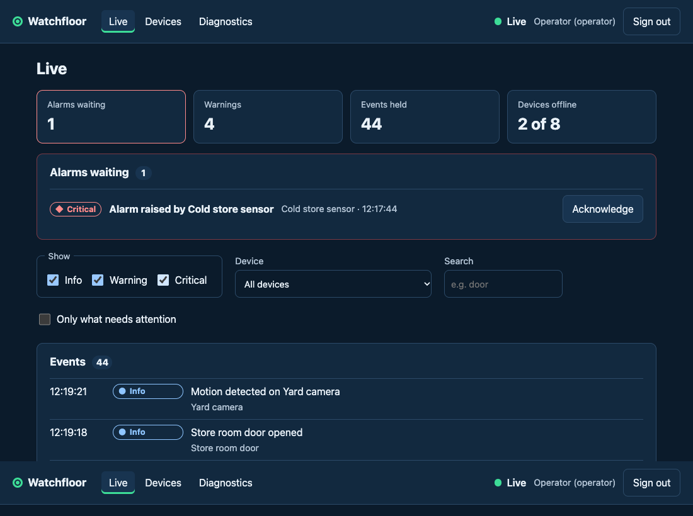

# Watchfloor

[](https://github.com/rveruna/watchfloor/actions/workflows/ci.yml)
[](https://github.com/rveruna/watchfloor/actions/workflows/codeql.yml)

**[Live demo](https://rveruna.github.io/watchfloor/)** (sign in with one click; the data is invented)



A live monitor for a few invented sites: a stream of device events (motion, doors, sensors going offline), alarms that
someone has to acknowledge, and, the part I wanted to get right, what the page does when the connection drops. It reconnects
with growing, randomised waits, fetches exactly the events it missed, shows each once and in order, and says in words what it
is doing. **Diagnostics → Cut the connection** drops it on demand so you can watch.

Built with Vue 3, Pinia and strict TypeScript. Everything is invented: the devices, the events, the two demo accounts. It is
not connected to any real product, camera or alarm system.

## What it does

- **Live events** from a numbered stream, with severity shown by word and shape as well as colour, and filters by severity,
  device and words
- **Alarms** waiting for a person. An operator can acknowledge; a viewer sees them but cannot. The first acknowledgement wins,
  and a refused one is taken back from the screen with a reason
- **Reconnects on its own**, waits longer each time (with jitter), spots a connection that has gone silent, and fills any hole
  in the numbering over REST
- **A diagnostics page**: the connection, the page's own Web Vitals, and a structured log; plus a button to cut the connection
- **Two ways to run it**: a demo that runs entirely in the page, and a build that talks to a mock server over HTTP and a
  websocket. The same screens, stores and engine run either way

## Run it

```bash
npm install
npm run dev               # the demo, no server needed
npm run dev:all           # the app against the mock server (HTTP + websocket)
npm test                  # 257 tests
npm run test:coverage
npm run arch              # the code's shape, as rules
npm run build:e2e && npm run e2e   # both modes in Chrome, with axe (29 checks)
```

Sign in as `operator@example.com` / `operator` (can acknowledge) or `viewer@example.com` / `viewer`.

## How it is built

```
shared/       the contract (Zod schemas), a seeded event generator, and the simulated deployment (World)
server/       the mock deployment: HTTP, cookie sign-in, a websocket
src/domain/   the rules as pure functions: event log, connection state machine, retry waits, filters
src/net/      REST client, sockets, the sync engine (the only place with timers), the in-page demo
src/stores/   Pinia: session, monitor (events, devices, acknowledging), telemetry
src/...       components, views, router, telemetry (logger, vitals, error handlers)
docs/decisions/   the reasoning behind the main choices
```

- **One contract, checked at every edge**: responses and stream messages are parsed, not cast, so a bad message is logged and
  ignored instead of reaching a screen ([0001](docs/decisions/0001-one-contract-in-one-place.md)).
- **The connection is a state machine** with no timers in it, so every path is tested without waiting
  ([0002](docs/decisions/0002-the-connection-is-a-state-machine.md)).
- **Numbered events and holes**: events can arrive late, twice or not at all, and an unacknowledged alarm is never dropped
  ([0003](docs/decisions/0003-numbered-events-and-holes.md)).
- **One simulated world with two front doors**, so the public demo cannot behave differently from the server
  ([0004](docs/decisions/0004-one-world-two-front-doors.md)).
- **The architecture is enforced**: a wrong import fails the build
  ([0005](docs/decisions/0005-architecture-as-rules.md)).
- **A page that changes by itself, made usable** ([0006](docs/decisions/0006-a-live-page-people-can-use.md)) and
  **seen in production** ([0007](docs/decisions/0007-seeing-the-frontend-in-production.md)).

## Practices

- **257 tests, 98% of statements and 94% of branches**: the rules, the engine against fake timers and sockets, the stores against
  the real demo, the whole app through its screens, and the server and the engine together over real HTTP and websockets
- **Property tests** (fast-check): any order and any repeats of events give the same log with no hole; retry waits stay in bounds
- **Hand-made mutants** of the event log, state machine, engine, client, world and server (30, checked once locally): the first
  pass missed five. Four became tests (a single missing event, a page that ends exactly at the hole, the largest allowed
  limit, a newest event that was let go and fetched again). The fifth, a redundant folder check in the static server, is
  equivalent, because the path is already normalised
- **Browser run of both modes, 29 checks**, with axe (WCAG 2.2 AA and best-practice rules) on every page at phone, small phone,
  tablet and desktop widths, and no sideways scroll. The run found real problems: a "no alarms" message shown before the first
  events arrived, a sign-in form whose error message became part of the field's name, and tables that scrolled the page at 320 px
- **CI**: lint (no warnings), formatting, types, architecture rules, coverage, build, the browser run, and a dependency audit
  on every push; CodeQL weekly and on pushes

## Accessibility

Severity and status are never only colour. A new alarm is announced to a screen reader, ordinary events are not, and
announcements are spaced out. The page never claims "no alarms" before it knows. There is a skip link, every control has a
name, and wide tables scroll in a labelled region instead of the page. Axe finds nothing in the browser. **I have not tested
with a screen reader** (see [0006](docs/decisions/0006-a-live-page-people-can-use.md)).

## Limits

- **Everything is invented and simulated.** The server is a few hundred lines of Node that keeps everything in memory. There
  is no database, no real device, no video, and no connection to any product.
- **The public demo runs in your page**, not against a server. Run `npm run dev:all` for the server version.
- **No Firebase and no Go backend.** See [0008](docs/decisions/0008-what-is-and-is-not-here.md).
- **No screen reader or real-device testing, and no load testing.** The list draws 100 rows and the log holds 2,000 events.
- **Nothing is sent to a collector.** The logger and the Web Vitals stay in the page.
